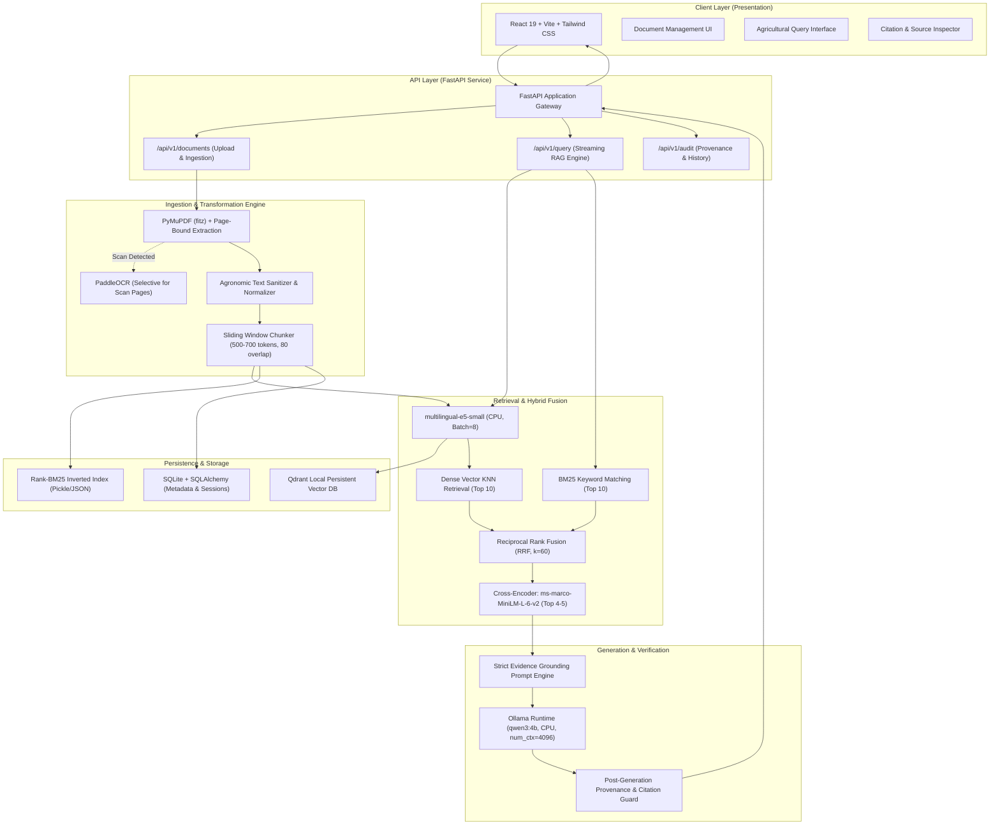

# KrishiRAG: System Architecture Specification

## 1. Executive Summary & Objective

**KrishiRAG** is a production-grade, retrieval-augmented agricultural advisory system designed to deliver verified, evidence-grounded agronomic recommendations strictly sourced from authentic Indian Council of Agricultural Research (ICAR) publications, state agricultural university manuals, and official government advisory packages of practices.

Every recommendation provided by the system must be completely traceable back to its origin:
$$\text{Response} \rightarrow (\text{Document Title}, \text{Verified Page Number}, \text{Verbatim Supporting Passage})$$

The system is optimized to operate on local consumer-grade hardware: AMD Ryzen 5 5500U (6 cores, 12 threads) with 8 GB physical RAM, utilizing CPU-only inference without dedicated GPU acceleration.

---

## 2. High-Level System Architecture



---

## 3. Layer-by-Layer Architectural Specification

### 3.1 Client Layer (Frontend)
- **Framework**: React 19 bootstrapped with Vite and TypeScript.
- **Styling**: Tailwind CSS with modern, clean UI design system (Linear/Stripe-inspired aesthetic).
- **Core Interfaces**:
  1. **Document Workspace**: Drag-and-drop upload for ICAR bulletins and packages of practices. Displays real-time ingestion status (extraction, chunking, embedding, indexing progress) and total pages indexed.
  2. **Advisory Chat Console**: Conversational interface supporting bilingual/multilingual queries (English, Hindi, regional agricultural terms like *kharif*, *rabi*, *pylla*, *boron deficiency*).
  3. **Evidence Inspector (Sidecar Drawer)**: Interactive drawer revealing exact citation pills. Clicking any citation renders the source document name, exact page number, and extracted source chunk excerpt to guarantee zero-hallucination trust.

### 3.2 Backend Service Layer (FastAPI)
- **Framework**: FastAPI (Python 3.12/3.14 compatibility).
- **Process Model**: Asynchronous ASGI server with `uvicorn`.
- **Resource Guarding**: Single-request concurrency lock (`asyncio.Semaphore(1)`) on inference-heavy endpoints to prevent memory thrashing on 8 GB RAM machines.
- **API Versioning**: Strict `/api/v1/` prefixing.
- **Error Handling**: Unified RFC 7807 compliant JSON error responses:
  ```json
  {
    "success": false,
    "error": {
      "code": "DOCUMENT_NOT_FOUND",
      "message": "The referenced ICAR manual was not found."
    }
  }
  ```

### 3.3 Document Ingestion Architecture
- **PDF Extraction**: Primary extraction with `PyMuPDF` (`fitz`), traversing page-by-page to tag every text fragment with its physical `page_number` (1-indexed).
- **Selective OCR Fallback**: If page text length is below 50 characters and contains embedded raster images, dynamically trigger `PaddleOCR` on that page only, preserving system memory.
- **Cleaning & Structuring**:
  - Remove running headers, footers, and redundant line breaks.
  - Retain tables and structured chemical dosage guidelines (e.g., *Chlorpyriphos 20 EC @ 2.5 ml/litre*).
- **Chunking Strategy**:
  - Semantic sliding window of approximately 500–700 tokens with an overlap of 80 tokens.
  - Absolute preservation of metadata on every chunk:
    ```python
    {
        "chunk_id": "doc_wheat_icar_2024_p14_c2",
        "document_id": "doc_wheat_icar_2024",
        "document_title": "ICAR Package of Practices for Wheat 2024",
        "page_number": 14,
        "token_count": 580,
        "text": "..."
    }
    ```

### 3.4 Embedding & Vector Storage Architecture
- **Embedding Model**: `intfloat/multilingual-e5-small`.
  - Dimension: 384.
  - Normalization: L2 normalized vectors for Cosine similarity search.
  - Instruction Prefixing: In accordance with E5 requirements (`query: <query>` for queries, `passage: <text>` for document passages).
- **Vector Database**: **Qdrant Local Persistent Mode**.
  - Deployed without Docker using local disk storage: `QdrantClient(path="./data/qdrant_db")`.
  - Zero daemon overhead; embedded in the Python process.
  - HNSW index with Cosine distance metric.
- **Batch Processing**: Ingestion embeddings generated with a maximum batch size of 8 to ensure memory safety on Ryzen 5 5500U.

### 3.5 Retrieval & Hybrid Search Architecture
- **Sparse Retrieval (Lexical)**:
  - `rank_bm25.BM25Okapi` indexing all tokenized chunks.
  - Preserves exact agronomic terms, pest names (*Nilaparvata lugens*), and chemical molecules (*Mancozeb 75 WP*) often diluted in dense vector spaces.
- **Dense Retrieval (Semantic)**:
  - Multilingual semantic search via Qdrant cosine distance.
- **Hybrid Fusion**:
  - Reciprocal Rank Fusion (RRF) combining Top-10 Dense and Top-10 Sparse candidates:
    $$RRF\_Score(d) = \frac{1}{60 + \text{Rank}_{dense}(d)} + \frac{1}{60 + \text{Rank}_{sparse}(d)}$$
- **Reranker**:
  - `cross-encoder/ms-marco-MiniLM-L-6-v2`.
  - Takes top 10 fused candidates, scores (Query, Chunk) pairs directly, and extracts the top 4–5 most relevant passages.

### 3.6 LLM Integration & Generation Architecture
- **LLM Runtime**: Ollama running locally.
- **Model**: `qwen3:4b` (quantized 4-bit, consuming ~2.5 GB RAM).
- **Context Management**: Strict context window configured to 4096 tokens (`num_ctx: 4096`), threads pinned to 4 (`num_thread: 4`) to leave CPU cores free for OS and I/O.
- **Evidence-Grounded Prompting**:
  - System instructions explicitly forbid generating recommendations without context citations.
  - Fallback protocol: If retrieved passages do not contain the answer, reply: *"The available ICAR documentation does not provide verified guidelines for this query."*
- **Citation Post-Validation**:
  - Regex and string containment check validating that cited page numbers and document titles correspond to chunks provided in the prompt context.

### 3.7 Database Design (SQLite + SQLAlchemy)
- Embedded SQLite (`./data/krishirag.db`) manages relational metadata:
  - `documents`: Document ID, title, file path, upload date, file hash, total pages, status.
  - `document_pages`: Page index, word count, OCR status.
  - `query_logs`: Timestamp, user query, retrieved chunk IDs, generated response, latency metrics.
  - `citations`: Relational link between query logs and specific document chunks.

---

## 4. Hardware Optimization & Resource Constraints

| Component | Target Allocations | Operational Strategy |
| :--- | :--- | :--- |
| **System RAM** | 8 GB Total (~7.33 GB visible, 0.72-1.5 GB free) | Single-concurrency locks, explicit `gc.collect()`, sequential execution |
| **Ollama (qwen3:4b)** | ~2.5 - 2.8 GB RAM | Keep idle when not generating; cap context at 4096 tokens |
| **Embedding Engine** | ~400 MB RAM | Unload or run in batch mode during document ingestion |
| **Cross-Encoder** | ~350 MB RAM | Lightweight MiniLM architecture, runs inference only on 10 candidate pairs |
| **Vector DB** | Embedded Qdrant | In-process, avoids standalone server/Docker overhead |
| **Disk Storage** | 205 GB available | Structured storage under `./data/` |
